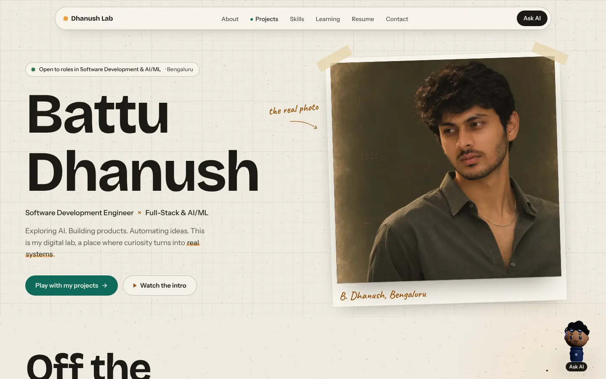
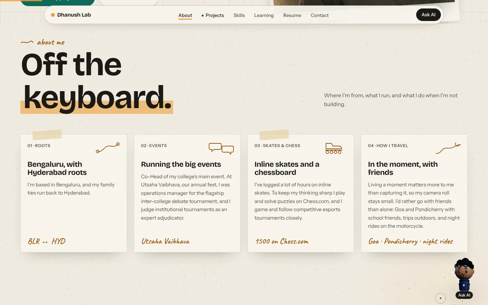
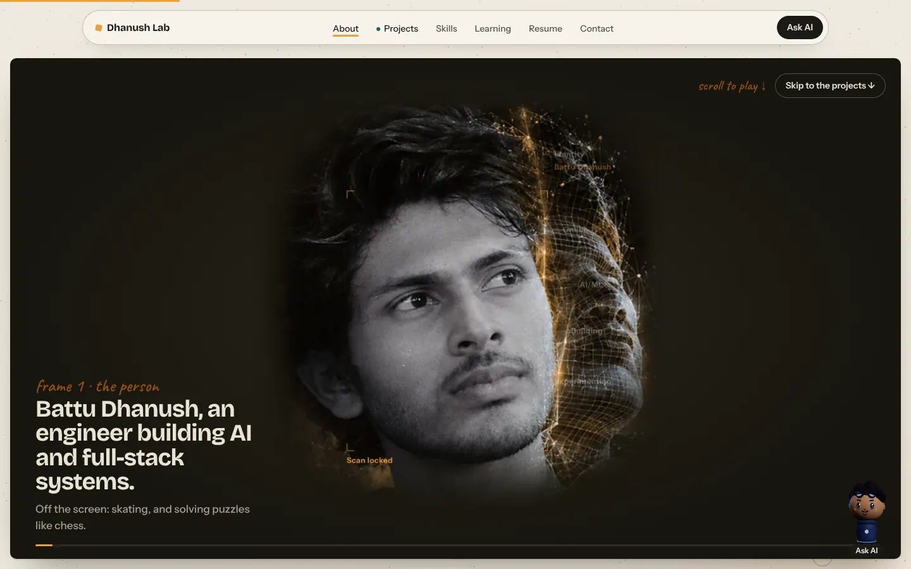
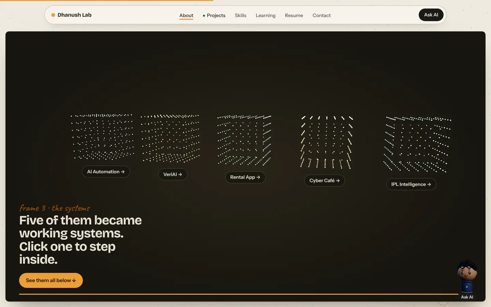
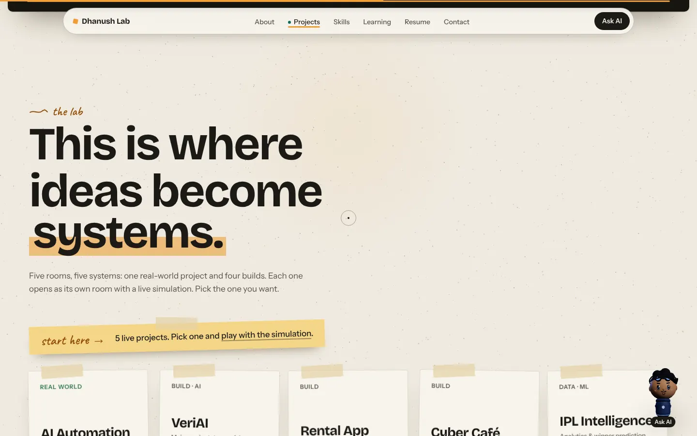
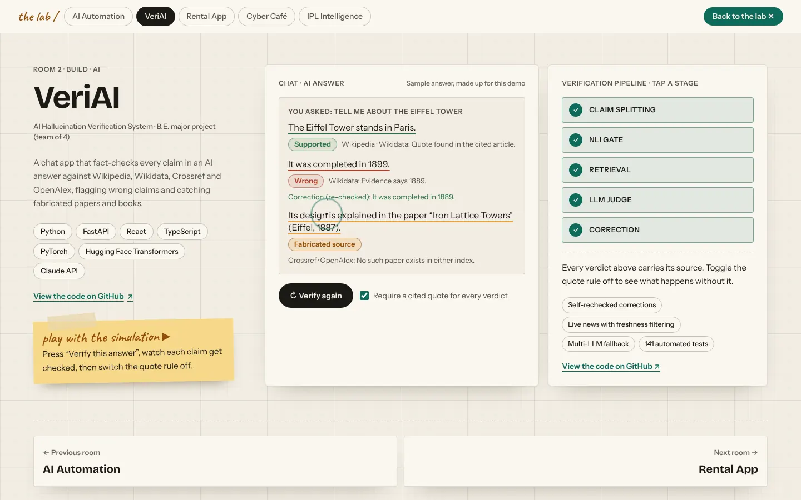
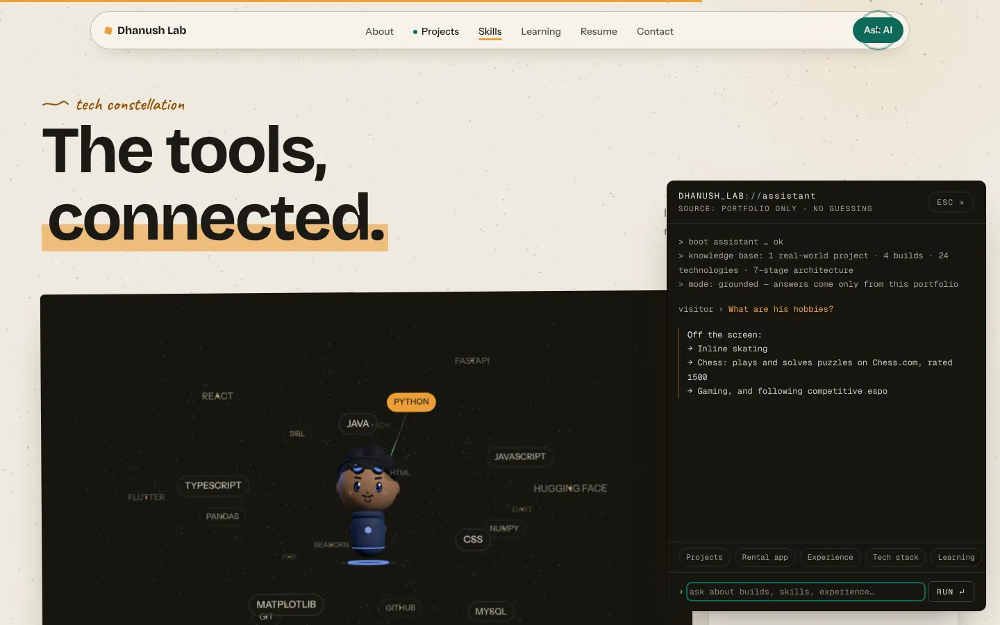

# DHANUSH LAB

The portfolio of **Battu Dhanush**, a software engineer building AI and full-stack systems in Bengaluru.

It's set up as a lab notebook: paper, pencil notes and highlighter. Each project opens as a room with a live simulation you can play with, and an on-page assistant answers questions about the work from the portfolio's own content.



## What's on the page

| Section | What it does |
|---|---|
| **Opening screen** | Name, roles, a short intro, and a button to jump straight to the projects. |
| **About me** | Four index cards: roots, events, skating and chess, and how he travels. |
| **Scroll film** | A dark screen that stays put while you scroll. A photo breaks into thousands of points, scatters into "ideas", then settles into five cubes, one per project. Click a cube's name to open it. |
| **The lab** | The five projects as cards. Each opens a full-screen room with a simulation. |
| **Tech constellation** | A 3D map of skills. Select a star to see where it was used. |
| **Learning and résumé** | Education timeline and a résumé viewer you can zoom (buttons, double-click, pinch or ctrl + scroll). |
| **Contact** | GitHub, LinkedIn, email and the résumé. |
| **Ask AI** | A terminal-style assistant (D-01) that answers only from `content/profile.ts`. |

<table>
  <tr>
    <td></td>
    <td></td>
  </tr>
  <tr>
    <td></td>
    <td></td>
  </tr>
  <tr>
    <td></td>
    <td></td>
  </tr>
</table>

## The projects

| Project | What it is | Code |
|---|---|---|
| **AI Automation** (Elite IIT, freelance) | WhatsApp Business API automation with a bilingual generative-AI assistant for marketing. | Client work |
| **VeriAI** | B.E. major project (team of 4). Fact-checks every claim in an AI answer against Wikipedia, Wikidata, Crossref and OpenAlex. | [verification-ai-v2](https://github.com/DhanushBattu/verification-ai-v2) |
| **Rental App** | Cross-platform marketplace in Flutter and Firebase, with KYC, role checks and transaction-safe bookings. | [Rental_main](https://github.com/DhanushBattu/Rental_main) |
| **Cyber Café** | Session tracking, computer allocation, billing and an admin dashboard. | |
| **IPL Intelligence** | Match analytics and winner prediction over IPL 2008–2024. | [IPL-Predictor-Analytics](https://github.com/DhanushBattu/IPL-Predictor-Analytics) |

## Built with

Next.js 15 (App Router, static export) · TypeScript · Tailwind CSS v4 · Framer Motion · GSAP (ScrollTrigger, DrawSVG) · Lenis · three.js and React Three Fiber

## Run it locally

You need Node.js 20 or later.

```bash
npm install
npm run dev      # http://localhost:3000
npm run build    # static site in ./out
```

## Deploy

**GitHub Pages (set up already).** `.github/workflows/deploy.yml` builds the site and publishes it on every push to `main`. Turn it on once: repo **Settings → Pages → Source: GitHub Actions**. The site then appears at `https://<username>.github.io/<repo-name>/`. The workflow handles the sub-path for you.

**Anywhere else.** Run `npm run build` and upload the `out` folder to Netlify, Vercel, Cloudflare Pages or any static host. To get correct link previews on your own domain, build with:

```bash
NEXT_PUBLIC_SITE_URL=https://your-domain.com npm run build
```

## Changing the content

All the text is in **`content/profile.ts`**, so you never need to touch a component to change words.

| What | Where |
|---|---|
| Name, roles, links, email, summary, hobbies | `profile` |
| About me cards | `aboutMe` |
| Experience and impact numbers | `experience` |
| Projects | `veriai`, `rental`, `cafe`, `ipl` (repo links in `profile.repos`) |
| Skills and where each was used | `tech` |
| Education and achievements | `education`, `achievements` |
| IPL chart figures | `content/ipl.ts` (public IPL records, 2008–2024) |

Images live in `public/img`:

- `dhanush-hero.webp`: the photo on the opening screen.
- `dhanush-portrait.webp` and `dhanush-portrait-map.png`: the scanned portrait used in the scroll film. The points are sampled from the map's pixels.
- `resume-full.webp` and `resume-preview.webp`: images of the résumé PDF (`public/resume/`). If you replace the PDF, regenerate these too.

## How the assistant works

It runs entirely in the browser, with no API calls and no key. It matches a question against the portfolio content and answers only from it. If nothing matches, it says so instead of guessing. The logic is in `components/assistant/engine.ts`.

To connect a real LLM later, add an API route that sends `content/profile.ts` as context with an "answer only from this" instruction, and call it from `ask()`. A static export has no server, so that route needs a server deployment such as Vercel.

## Project structure

```
app/                  layout (SEO, fonts), page, globals.css (colours and type), icons, OG image
content/              profile.ts (all text), ipl.ts (chart data)
components/
  hero/               Hero, ScanLabels
  sections/           About, ScrollFilm, Lab, Constellation, Education, Resume, Final
  rooms/              ProjectRooms (full-screen project pages), ExperienceDemo
  builds/             VeriAI, RentalApp, CyberCafe, IplData (the simulations)
  three/              FilmScene, DustField, ConstellationScene, Doll, DollCanvas, AiCore
  layout/             Loader, Nav, SmoothScroll, NotebookMotion, BackgroundDust
  assistant/          AskAI (terminal UI), engine (grounded answers)
  ui/                 Cursor, Magnetic, Reveal, SectionHead, Tilt, Counter
lib/                  store (UI state), scroll, hooks, resume download, scan timing
.github/workflows/    deploy.yml (GitHub Pages)
```

## Performance and accessibility

- three.js is split out and only loads when the browser supports WebGL. Every canvas pauses when it's off-screen.
- Phones get fewer particles and a lower pixel ratio, and the skills map becomes a list of tappable chips.
- **Agent swarm:** after the loading screen, a swarm of "agent" cursors with name tags drag wireframe boxes over the opening screen and each piece appears inside its box. Then the page scrolls itself from top to bottom (about 25 seconds), pausing while agents build each section: About, the scroll film, projects, skills, education, résumé and contact. Every visit starts at the top, and the tour stops at the bottom. Scrolling yourself, pressing Stop, or opening a project, the résumé or the assistant hands control straight back (`components/layout/AgentBuild.tsx`).
- Motion is small and purposeful: the photo print tilts toward the cursor, cards lift and tilt on hover, doodles redraw, text rises in as it scrolls into view, and headings drift with a light parallax. All of it is in `components/layout/NotebookMotion.tsx`, `components/ui/Tilt.tsx` and `components/ui/Magnetic.tsx`.
- With reduced motion turned on, there is no smooth scrolling, no loader, no tilt or parallax and no animated WebGL; the scroll film becomes a single still frame.
- Semantic landmarks, a skip link, visible focus states and real buttons throughout. Overlays close with Esc, and the IPL charts include a screen-reader table.

## Credits

- Fonts: Bricolage Grotesque, Instrument Sans and Caveat (via Fontsource), Geist Mono.
- The cursor dust and scroll film take their idea from ThreeUI's "Anima" and "Kage" templates. The code here is original.

The photos and personal content are © Battu Dhanush and aren't licensed for reuse.
